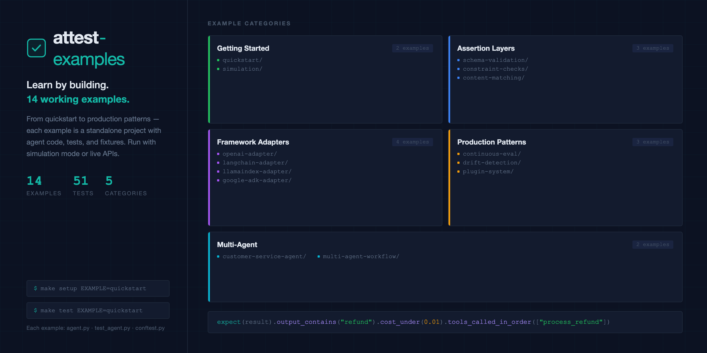

[](https://github.com/attest-framework/attest-examples)

---

# attest-examples

Showcase examples for [Attest](https://github.com/attest-framework/attest) — the AI agent evaluation framework. Documentation: [attest-framework.github.io](https://attest-framework.github.io/).

This repository holds one small, copyable example per feature or framework and pins the latest stable release, 1.1.0 (`attest-ai==1.1.0` and `@attest-ai/core` / `@attest-ai/vitest` `1.1.0`). For one end-to-end story — incident, reproduction, fix, blocked regression — see [refund-desk](https://github.com/attest-framework/refund-desk).

| Repo | Role | Tracks |
|---|---|---|
| `attest-examples` | One small, copyable example per feature or framework | Latest published release |
| [`refund-desk`](https://github.com/attest-framework/refund-desk) | One end-to-end story: incident → reproduction → fix → blocked regression | attest `main` until 1.0.0, then 1.0.x |

To add Attest to your own project:

```bash
uv add "attest-ai==1.1.0"                                                   # Python
npm install -D "@attest-ai/core@1.1.0" "@attest-ai/vitest@1.1.0" vitest # TypeScript
```

---

## Getting Started

Start with [quickstart/](quickstart/) — a minimal end-to-end example that runs a single assertion against a live agent response.

```bash
make setup EXAMPLE=quickstart
make test EXAMPLE=quickstart
```

See [quickstart/README.md](quickstart/README.md) for a step-by-step walkthrough.

---

## Assertion Layers

Each example targets a specific layer of Attest's assertion stack.

| Example                                            | Layer                      | Description                                               |
| -------------------------------------------------- | -------------------------- | --------------------------------------------------------- |
| [semantic-similarity/](semantic-similarity/)       | L5 — Embeddings            | Cosine-similarity checks on response vectors              |
| [rag-chatbot/](rag-chatbot/)                       | L5 + Retrieval             | Embedding assertions combined with retrieval faithfulness |
| [llm-judge/](llm-judge/)                           | L6 — Quality gates         | LLM-as-judge scoring with pass/fail thresholds            |
| [simulation/](simulation/)                         | L7 — Mock tools & personas | Simulated tool calls and synthetic user personas          |
| [multi-agent-workflow/](multi-agent-workflow/)     | L8 — Trace trees           | Assertion over multi-hop agent trace graphs               |
| [customer-service-agent/](customer-service-agent/) | All 8 layers               | Full-stack evaluation across every assertion layer        |
| [relational-effects/](relational-effects/)             | L3 — World effects         | Sum partial refunds per order and match notification recipients |

---

## Framework Integrations

| Example                                | Description                                     |
| -------------------------------------- | ----------------------------------------------- |
| [langchain-agent/](langchain-agent/)   | Wrap a LangChain agent with Attest assertions   |
| [llamaindex-agent/](llamaindex-agent/) | Evaluate a LlamaIndex query pipeline            |
| [google-adk/](google-adk/)             | Assert over Google Agent Development Kit agents |
| [crewai-adapter/](crewai-adapter/)     | Plug Attest into a CrewAI multi-agent crew      |

---

## Framework capture through OpenTelemetry

These frameworks are captured with `attest capture` through their own OpenTelemetry instrumentation, with no attest-specific adapter. Each example commits its fixture and the test `attest capture` drafted; all but the Claude Agent SDK examples also commit a strict replay test that runs the real agent with zero model calls and no provider key (Claude Code puts the working directory, OS and date into its requests, which replay does not normalize yet; see those READMEs). Re-capture against [`scripted-model/`](scripted-model/), a stdlib model server.

CI runs each with `0 live model calls` asserted from its report: the five examples with a replay test must show a replay summary with every call replayed, and the two Claude Agent SDK examples must show no live call and every assertion passing.

| Example | Framework | Instrumentation | Run |
|---|---|---|---|
| [pydantic-ai/](pydantic-ai/) | Pydantic AI (Python) | native `InstrumentationSettings(version=5)` | `make test EXAMPLE=pydantic-ai` |
| [vercel-ai-ts/](vercel-ai-ts/) | Vercel AI SDK (TypeScript) | native `@ai-sdk/otel` | `cd vercel-ai-ts && pnpm install && pnpm test` |
| [mastra-ts/](mastra-ts/) | Mastra (TypeScript) | native `@mastra/otel-exporter` | `cd mastra-ts && pnpm install && pnpm test` |
| [claude-agent-sdk/](claude-agent-sdk/) | Claude Agent SDK (Python) | Claude Code native traces (beta); no replay test, see its README | `make test EXAMPLE=claude-agent-sdk` |
| [claude-agent-sdk-ts/](claude-agent-sdk-ts/) | Claude Agent SDK (TypeScript) | Claude Code native traces (beta); no replay test, see its README | `cd claude-agent-sdk-ts && pnpm install && pnpm test` |
| [openai-agents/](openai-agents/) | OpenAI Agents SDK (Python) | `opentelemetry-instrumentation-openai-agents-v2` (alpha) | `make test EXAMPLE=openai-agents` |
| [langgraph/](langgraph/) | LangGraph (Python) | LangSmith in OTel mode, local exporter only | `make test EXAMPLE=langgraph` |

---

## Production Patterns

| Example                              | Description                                   |
| ------------------------------------ | --------------------------------------------- |
| [continuous-eval/](continuous-eval/) | Run assertions in CI on every deployment      |
| [drift-detection/](drift-detection/) | Alert on assertion score regression over time |
| [plugin-system/](plugin-system/)     | Register custom assertion plugins             |

---

## TypeScript Examples

TypeScript ports using `@attest-ai/core` and `@attest-ai/vitest` with vitest.

| Example                                              | Description                                    |
| ---------------------------------------------------- | ---------------------------------------------- |
| [quickstart-ts/](quickstart-ts/)                     | Customer support agent — layers 1-4            |
| [openai-adapter-ts/](openai-adapter-ts/)             | OpenAI chat + tool calling traces              |
| [schema-assertions-ts/](schema-assertions-ts/)       | Layer 1 schema validation (output, fields, tools) |
| [content-assertions-ts/](content-assertions-ts/)     | Layer 4 content checks (keywords, regex, forbids) |
| [relational-effects-ts/](relational-effects-ts/)     | Relational world effects: refund totals and recipients |

```bash
cd quickstart-ts && pnpm install && pnpm test
```

---

## Running Examples

```bash
# Set up and test a single example
make setup EXAMPLE=llm-judge
make test  EXAMPLE=llm-judge

# Run all examples in sequence
make test-all
```

### Relational world effects

[`relational-effects/`](relational-effects/) and
[`relational-effects-ts/`](relational-effects-ts/) issue two partial refunds and a
notification through real HTTP to a local, stateful payments world. No model or
provider key is used. The `sum` check groups refunds by `order_id` and compares
their total with the related order's amount; `matches` compares the notification
recipient with that order's customer. Checking each tool call alone cannot prove
either invariant.

```bash
make setup EXAMPLE=relational-effects
make test EXAMPLE=relational-effects
cd relational-effects-ts && pnpm install && pnpm typecheck && pnpm test
```

Each test starts an isolated world from `payments.world.yaml`; the two orders
have different amounts and customers. Changing the second refund to the full
order amount makes `sum` fail; sending the notification to the other customer
makes `matches` fail. See the
[relational effects guide](https://github.com/attest-framework/attest/blob/main/docs/guides/world-fixtures.md#relational-effects-totals-and-recipients)
and [refund-desk](https://github.com/attest-framework/refund-desk) for a full incident.

Requires [uv](https://github.com/astral-sh/uv) for Python and [pnpm](https://pnpm.io) for TypeScript.

No API key is needed. Every example evaluates against the real Attest engine: schema, constraint, trace, content and trace-tree assertions (layers 1–4 and 7) run on every test. Without a provider key, tests that also use embeddings (L5) or an LLM judge (L6) are skipped as `not evaluated: provider_not_configured`, and the framework examples that call a live model (`langchain-agent`, `llamaindex-agent`, `google-adk`) are skipped with the key they need. Export the keys listed in [`.env.example`](.env.example) to run them.

## CI

[`.github/workflows/ci.yml`](.github/workflows/ci.yml) runs each example on the pinned release, writes an Attest report, evaluates [`attest.policy.yaml`](attest.policy.yaml) (any hard failure blocks; not-evaluated assertions warn) and, in a separate job that holds the only write permission, posts one summary comment and annotates each failed assertion at its test's line (`pr-annotate` v2). An advisory `edge` job runs the same examples against attest `main`.

The 1.1 pin diff temporarily disables `block_on_regression` and the required-main-baseline
check because C3 assertion/baseline identity changes in 1.1. Hard failures still block.
Regression blocking should be restored only once main has fresh 1.1 reports for every example.

---

## Related

- [attest](https://github.com/attest-framework/attest) — SDK and core framework
- [attest-bench](https://github.com/attest-framework/attest-bench) — Benchmarks (private, for contributors)
- [attest-ai on PyPI](https://pypi.org/project/attest-ai/)

---

## License

[Apache-2.0](LICENSE)
